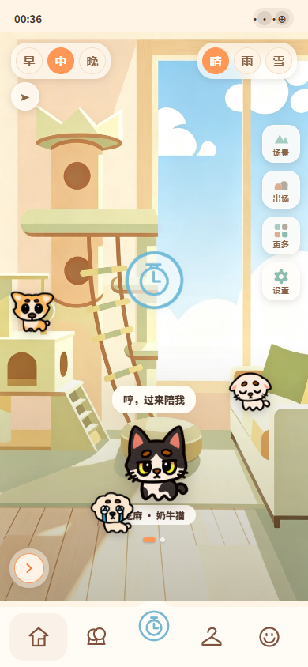
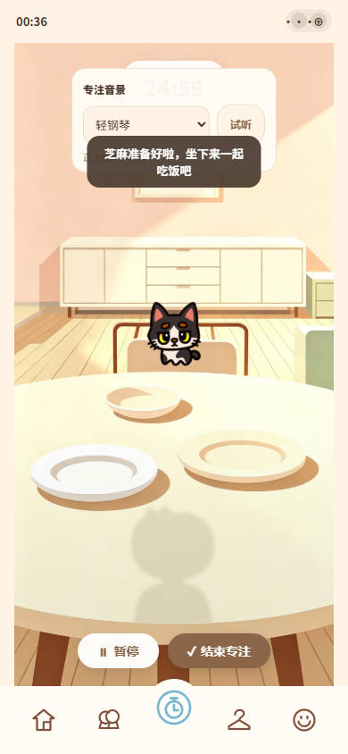
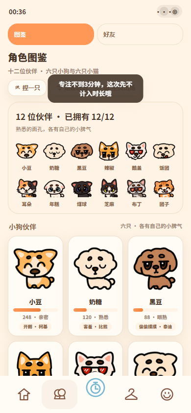

# 爪点时间

**找点时间，和小动物一起专注。**

[GitHub 仓库：claw-time](https://github.com/tutouguai1933/claw-time)

「爪点」谐音「找点」，把小动物的爪子和为自己留一点时间连在一起。项目原型原名「轻陪伴专注」，现以「爪点时间」作为项目名称。

这是一个以小动物陪伴为主题的高保真 Web 交互原型，将专注计时、伙伴养成、房间装饰和角色创作放进一间暖色插画小屋。适合用于产品体验展示、交互设计演示，以及继续开发陪伴式专注工具。

项目使用原生 HTML、CSS 和 JavaScript 实现，浏览器运行无需安装依赖或执行构建。可直接打开体验本地模式，也可使用附带的轻量 Node.js＋SQLite 服务启用服务器注册登录与个人存档同步。真实支付和在线社交服务尚未接入。

## 界面预览

<p align="center">
  
  
  
</p>

## 可以体验什么

| 模块 | 主要体验 |
| --- | --- |
| 陪伴小屋 | 切换场景、时间与天气，观察伙伴走动、碰面和性格对话 |
| 专注陪饭 | 选择 15 / 25 / 45 / 60 分钟时长、设置任务、摆放菜品，开始或暂停专注 |
| 伙伴收集 | 六只小狗、六只小猫，以及额外伙伴；通过签到、鱼币等方式解锁 |
| 角色创作 | 自由绘画与捏脸，制作自己的陪伴角色 |
| 装扮与布置 | 试穿装扮、微调穿戴位置、更换家具、摆放装饰，并导出小屋图片 |
| 成长与记录 | 保存专注记录、累计时长、签到进度、阶段奖励和称号 |
| 个人空间 | 本地或服务器注册登录、切换账号、选择头像；服务器模式支持跨设备存档同步 |
| 声音与互动 | 背景音乐、场景音、按钮音效，以及未联网的伙伴 PK 体验 |

五个主要页面分别为「小屋」「专注」「角色」「装扮」「我的」。部分互动、商品和社交界面属于演示内容，具体边界见下方说明。

## 快速开始

### 直接打开

下载或克隆完整项目，使用 Chrome 或 Edge 打开根目录的 `index.html`，会自动进入 `current_project.html`。也可以直接打开后者。

**请保留完整的 `assets/` 目录及其相对位置。** 只下载 HTML 文件会缺少角色、场景、脚本和样式。

Windows PowerShell 中，在项目根目录执行以下命令即可打开项目；预期浏览器显示小屋首页：

```powershell
Start-Process .\index.html
```

### 使用本地 HTTP 服务（可选）

如果电脑已经安装 Python，也可以在项目根目录启动静态服务。先确认命令存在，再启动；预期终端显示监听端口 8000：

```powershell
Get-Command python
python -m http.server 8000 --bind 127.0.0.1
```

在浏览器中打开 [本地预览](http://localhost:8000/)。在终端按 `Ctrl+C` 停止服务。项目本身不要求安装 Python。

## 技术实现

- **页面与交互**：原生 HTML / CSS / JavaScript，主页面组合多个功能脚本，没有前端框架或打包流程。
- **图形与素材**：本地 PNG / SVG、Canvas 图像处理、家具与场景分层合成。
- **数据保存**：静态模式使用 `localStorage`；服务器模式通过 Node.js 内置 SQLite 保存账号和个人 JSON 存档，浏览器保留待同步副本。
- **服务器账号**：内置 Crypto 的 scrypt 派生密码，HttpOnly Cookie 会话，按用户隔离存档，版本校验防止多设备相互覆盖。
- **场景缓存**：`assets/scene-cache/` 保存供页面按需加载的图片数据，以支持直接打开 HTML 时的场景合成与导出。
- **开发验证**：Node.js 检查脚本与 Playwright 浏览器回归；部分图像检查使用 `pngjs`、`sharp`。

运行页面不需要 Node.js。执行开发脚本和测试时才需要相应工具；仓库未提供统一的依赖清单，历史脚本的环境限制见 [开发与验证说明](docs/DEVELOPMENT.md)。

## 启用服务器账号

使用已安装、支持 `node:sqlite` 的 Node.js 22.13+（建议 Node.js 24）。无需安装 npm 包。在项目根目录执行，预期终端显示端口 3080：

```powershell
Get-Command node
node --version
node .\server\index.cjs
```

打开 [服务器模式本地预览](http://localhost:3080/)。默认数据库位于 `data/claw-time.sqlite`，不随 Git 提交。注册时可选择导入当前游客记录；已有本地账号不会自动变成服务器账号。详细配置、容器部署和备份方法见 [服务器部署说明](docs/DEPLOYMENT.md)。

## 项目结构

```text
.
├── index.html                 # 静态站点默认入口，跳转到主页面
├── current_project.html       # 主页面、核心状态与交互
├── assets/                    # 页面脚本、样式与完整本地素材
│   ├── profile-store.js       # 本地账号与存储
│   ├── app-profile-bridge.js  # 账号快照与应用状态桥接
│   ├── pet-*.js               # 伙伴互动、小屋行为与 PK
│   ├── breed-creator.js       # 角色捏脸创作
│   ├── house-editor.js        # 小屋编辑与图片导出
│   ├── pets-v2/               # 小狗素材
│   ├── cats-v4/               # 当前使用的小猫素材
│   ├── cats-v1/ ~ cats-v3/    # 历史素材，供追溯与回归验证
│   ├── scene-clean/           # 当前展示的基础场景
│   └── scene-cache/           # 浏览器运行所需的本地场景数据
├── scripts/                   # 素材处理与缓存生成工具
├── server/                    # 无第三方依赖的账号、存档与静态资源服务
├── deploy/                    # Docker 运行脚本
├── data/                      # SQLite 运行数据，不提交 Git
├── tests/                     # 自动化检查与浏览器回归
├── docs/
│   ├── images/                # README 展示截图
│   ├── PROJECT_HANDOVER.md    # 详细技术交接文档
│   ├── DEVELOPMENT.md         # 开发环境与验证方法
│   ├── GITHUB.md              # Git 提交与上传说明
│   └── research/              # 本地开发研究与调试记录，默认不提交
├── output/                    # 本地作品集、预览与导出物，默认不提交
├── .gitattributes             # 文本处理规则，素材保持原始字节
└── .gitignore                 # Git 提交排除规则
```

`assets/scene-cache/` 虽然名为 cache，但属于现有页面运行资源，应随项目提交。旧版角色素材也有回归脚本引用，暂时保留，不按冗余文件删除。

## 数据与原型边界

- **两种模式**：直接打开 HTML 或使用纯静态托管时，账号和记录仅在当前浏览器；使用 Node.js 服务时，服务器账号可跨设备恢复存档。
- **存储隔离**：不同域名、端口及本地文件的浏览器存储互不共享。游客与旧本地账号不自动上传；清除浏览器数据会删除游客记录和尚未同步的副本，已同步的服务器存档保留。
- **同步边界**：网络失败会保留待同步副本并重试；多设备版本冲突会停止写入，允许备份后重新载入云端存档。鱼币、奖励和 PK 仍是客户端原型逻辑，不作为可信支付或排行榜依据。
- **支付演示**：现金装扮、首充和礼包入口未开通真实支付；鱼币兑换属于应用内体验。
- **社交演示**：搭子、广场及 PK 相关界面不代表已经实现在线匹配或真实用户对战。
- **外部资源**：主要角色和场景已本地化，但代码仍有部分图片和背景音乐外链，无法保证完整离线体验或外链长期可用。
- **平台形态**：当前交付物是 Web 原型，不是可直接发布到微信平台的小程序工程。

## 开发与发布

- [开发与验证说明](docs/DEVELOPMENT.md)：测试入口、工具要求及现有脚本限制。
- [上传 GitHub](docs/GITHUB.md)：首次提交、配置远程仓库和静态发布说明。
- [服务器部署说明](docs/DEPLOYMENT.md)：运行环境、持久存储、备份和回滚。
- [项目交接文档](docs/PROJECT_HANDOVER.md)：状态设计、模块职责、素材追溯及历史验证记录。

插画、音频和参考素材的来源记录、提示词及校验信息保留在各素材目录。仓库尚未声明统一的开源许可证，代码和素材的使用授权需分别明确。
